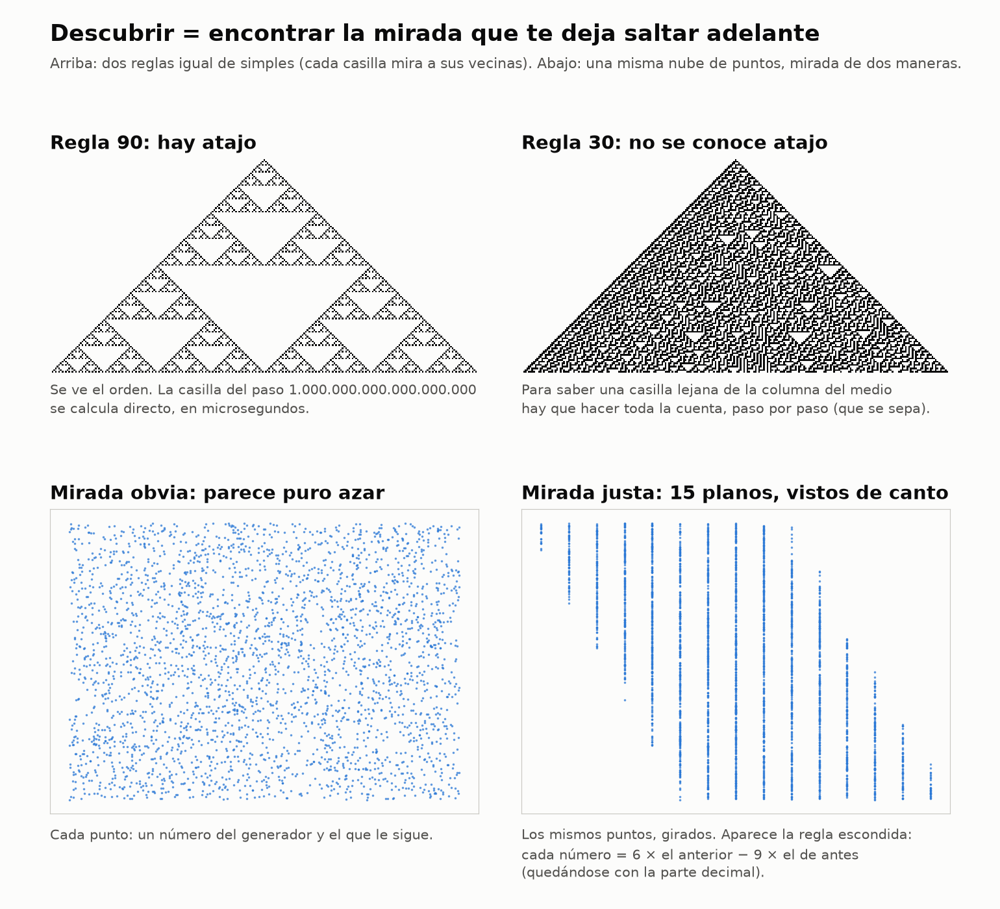
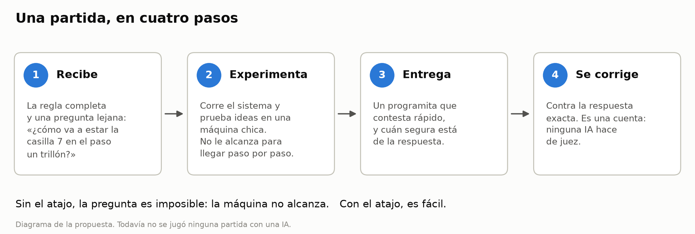
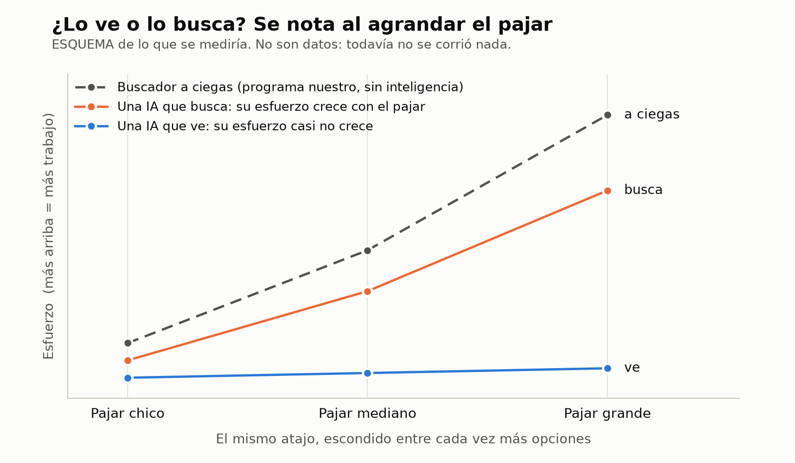

# Guía en llano: cómo sería nuestra investigación

> **Qué es esto.** Una guía corta, para Lucas. Cuenta sin jerga qué investigaríamos, cómo sería un
> experimento y qué haríamos primero. Se lee en unos 7 minutos.
>
> **Estado: es una propuesta, no está decidida. Todavía no se corrió nada con una IA.**
>
> **Dónde leerla y editarla.** La versión de trabajo es el Claude Doc editable, donde Lucas edita y
> comenta: <https://claude.ai/artifact/FR8Ty1b5pqsjAiUgahBBHX>. Hay además una página con figuras
> interactivas: <https://claude.ai/artifact/SkZcqybGYf7nhKx1G5iboo> (su fuente es
> [`2026-11-15-guia-atajos.html`](2026-11-15-guia-atajos.html)). Los dos enlaces son privados de Lucas.
> **Este archivo es la copia del repo**: si el Doc cambia, hay que traer acá los cambios.
>
> El detalle, las fuentes y las críticas están en el
> [documento largo](2026-11-15-reformulacion-descubrir-es-encontrar-un-atajo.md). Esta guía no agrega
> nada nuevo: lo baja a tierra.

---

## 1. La pregunta

Cuando una IA resuelve algo difícil, ¿**se le ocurrió** la idea, o **probó cosas hasta que una funcionó**?

Desde afuera las dos cosas se ven igual: el problema quedó resuelto. Pero no son lo mismo. Probar hasta
que salga sirve mientras las opciones son pocas. Cuando son millones, solo sirve que se te ocurra.

Es la pregunta de siempre de este proyecto (¿existe "el salto"?), dicha de una forma que se puede medir.

## 2. Por qué hasta ahora no pudimos medirla

En los mundos que armábamos antes, **la regla estaba escondida**. La IA tenía que adivinarla mirando datos.

Cuando fallaba, no sabíamos por qué. Podía ser que le faltaran datos. O que los datos tuvieran ruido. O
que no le conviniera esforzarse. O que de verdad no se le ocurriera. Cuatro explicaciones para un mismo
resultado: así no se puede concluir nada.

## 3. La idea: no esconder nada

Si esconder la regla trae tantas excusas, la salida es no esconderla. **La IA ve la regla completa.**

Pero entonces, ¿qué queda por descubrir?

Queda esto. Hay sistemas de reglas muy simples donde, para saber qué va a pasar dentro de mucho tiempo, la
única forma conocida es calcular paso por paso. Si te preguntan por el paso un trillón, no llegás nunca.

Salvo que encuentres un **atajo**: una manera de saltar directo al futuro sin recorrer el camino.

Un atajo de todos los días: ¿qué día de la semana va a ser dentro de 1.000 días? Nadie cuenta mil días con
el dedo. Te das cuenta de que la semana se repite cada 7, dividís, y listo. *Darte cuenta de eso* es el
atajo.

Stephen Wolfram, un físico que estudia estos sistemas hace cuarenta años, dice que la esencia de
descubrir es eso: encontrar un atajo donde parecía que había que hacer toda la cuenta.

*Arriba: dos sistemas con reglas igual de simples. El de la izquierda dibuja un patrón ordenado y tiene
atajo. Para el de la derecha nadie encontró uno en cuarenta años. Abajo, la misma idea de otra forma: los
mismos puntos parecen puro azar mirados de frente, y son 15 láminas ordenadas mirados desde el ángulo
justo. Muchas veces, encontrar el atajo es encontrar desde dónde mirar.*

## 4. Una partida, paso a paso

1. **Recibe** la regla completa y una pregunta lejana. Por ejemplo: "¿cómo va a estar la casilla 7 en el
   paso un trillón?".
2. **Experimenta** en una computadora chica que le prestamos. Puede correr el sistema, mirar y probar
   ideas. Pero tiene un tope: le alcanza para cientos de miles de pasos, no para un trillón.
3. **Entrega** un programita que contesta rápido ese tipo de preguntas, y dice cuán segura está.
4. **Se corrige** contra la respuesta exacta. Es una cuenta: ninguna IA hace de juez.

**El puntaje.** 1 es todo bien. 0 es "no encontré nada, y lo admito". Negativo es estar segura y
equivocada. O sea: decir "no sé" cuando no sabés está bien visto, e inventar se castiga.

**Lo importante del diseño.** Sin el atajo, la pregunta es imposible, porque la máquina no alcanza. Con el
atajo, es fácil. No queda un término medio donde esconderse.

## 5. ¿Y nosotros cómo sabemos la respuesta? Armando el juego al revés

Como quien arma un crucigrama: primero las respuestas, después las pistas.

1. Elegimos un atajo que la matemática ya conoce.
2. Armamos una regla que lo tenga.
3. **La disfrazamos**: le cambiamos los nombres a los símbolos, para que el atajo no se note.

Pensalo como una tabla de sumar donde alguien cambió los números por dibujos. Sigue siendo una suma, pero
ya no se ve. Para encontrar el atajo hay que darse cuenta de qué dibujo es qué número.

El disfraz es la perilla de dificultad. Con poco disfraz, el atajo salta a la vista. Con mucho, hay que
encontrar "desde dónde mirar".

Esto ya lo probé con cuentas, sin IA. En un sistema disfrazado, con el atajo el paso un trillón sale en
2 milisegundos. Sin el atajo no hay caso: el sistema recién vuelve a repetirse después de unos
794 billones de pasos.

Lo que **no** se puede armar al revés es lo contrario: garantizar que un sistema no tiene atajo. Eso hoy
nadie lo sabe demostrar. Para esos casos usamos sistemas donde nadie encontró uno.

## 6. Cuatro tipos de mundo

| Mundo | Qué tiene | Qué debería hacer una buena IA |
|---|---|---|
| **Con atajo** | un atajo plantado y disfrazado | encontrarlo |
| **Sin atajo** | nada conocido que encontrar | darse cuenta y decir "no sé" |
| **Trampa** | un patrón que se cumple mucho tiempo y después se rompe | no confiarse |
| **Salvaje** (más adelante) | una regla elegida al azar: nadie sabe si hay atajo | si encuentra uno, es un descubrimiento de verdad |

Los dos del medio miden algo que casi nadie mide: **cuántas veces una IA cree haber descubierto algo que
no está.**

Un ejemplo de trampa, ya verificado: una casilla repite el mismo dibujo 118 veces seguidas, y a la vuelta
siguiente cambia. El que dice "lo vi 118 veces, así que sigue igual" se equivoca. El que entendió *por
qué* pasaba, no.

## 7. La medida: ¿lo vio o lo buscó?

Que la IA encuentre el atajo no nos dice *cómo* lo encontró. Para eso hay un truco viejo de la psicología.

Una manzana roja entre manzanas verdes la encontrás al instante, haya 10 o 1.000. Eso es **ver**.
Una cara conocida en una multitud: cuanta más gente, más tardás. Eso es **buscar**.

La diferencia no está en si la encontrás. Está en **cuánto más te cuesta cuando el pajar es más grande**.

Nosotros podemos agrandar el pajar a voluntad: el mismo atajo, escondido entre más opciones. Y medimos
cuánto trabajo le costó a la IA: cuánto razonó, cuántos experimentos hizo, cuánto tiempo de máquina usó.

- Si el esfuerzo de la IA **casi no sube**, lo ve.
- Si **sube como el del buscador a ciegas**, lo busca.

El **buscador a ciegas** es un programa nuestro, sin inteligencia, que prueba opciones una por una. Es la
vara contra la que comparamos. En las cuentas que ya hice, le funciona más o menos 1 de cada 6 intentos en
el pajar chico, 1 de cada 30 en el mediano y 1 de cada 120 en el grande. (El chico lo verifiqué de punta
a punta; de los otros dos solo conté las opciones.)

Dos cuidados:

- **Solo cuentan las partidas resueltas.** Una IA que se rinde también trabaja poco, y eso no es ver.
- **Si el atajo es un truco de manual**, que el esfuerzo no suba solo dice "ya lo conocía".

## 8. Qué puede salir, y qué querría decir

| Si pasa esto… | …quiere decir | Qué hacemos |
|---|---|---|
| Resuelve todo, hasta lo más disfrazado | el juego les queda fácil a las IAs de hoy | lo endurecemos o lo cerramos |
| No resuelve ni cuando le nombramos la idea | el juego está mal armado | arreglamos el juego; no culpamos a la IA |
| Resuelve, y su esfuerzo crece como el del buscador a ciegas | busca | resultado: "no ven, buscan" |
| Resuelve, y su esfuerzo casi no crece | ve | resultado: "ven" (si no era un truco de manual) |

Las dos últimas son resultados que se pueden contar. Y estas reglas de lectura quedan escritas **antes** de
correr nada, para no acomodarlas después.

## 9. Qué hizo ya otra gente, y qué sería lo nuestro

- **DeepMind (octubre de 2026)** mostró que una IA puede encontrar atajos de verdad, en problemas que nadie
  había resuelto. Pero la "manera de mirar" se la armó un programa escrito por personas, encuentra un solo
  tipo de atajo, y no midieron cómo lo encuentra.
- **Dos trabajos (2025 y 2026)** ya miraron si las IAs resuelven por fuerza bruta o con algo más fino. Uno
  se llama, literalmente, "¿Creatividad o fuerza bruta?". Para decidirlo, los dos pusieron a otra IA a
  leer la solución. Uno de ellos usó acertijos sacados de internet.
- **Una línea más vieja** hace algo parecido con programas (encontrar una propiedad que se cumple en todas
  las vueltas). En su prueba clásica, las IAs ya sacan puntaje perfecto.
- **Lo nuestro sería la regla limpia**: sin IA de juez, con mundos armados por nosotros y con el atajo
  plantado. Hasta donde busqué, eso no lo hizo nadie. Y las trampas tampoco.

Dicho con honestidad: no es "nadie pensó en esto". Es **"nadie lo midió limpio"**. Y busqué bastante pero
no todo: 21 búsquedas, leyendo resúmenes y no los trabajos enteros.

Tres ajustes que salieron de mirar lo que hicieron otros:

1. El titular no es la pregunta (ya está hecha). Es la manera limpia de contestarla.
2. El centro pasa a ser el disfraz y las trampas. Lo de "cosas que se conservan" sale del centro, porque
   ahí las IAs ya están en el techo.
3. La regla de contar solo las partidas resueltas (ver el punto 7).

## 10. El plan, bajado a tierra

| Paso | Qué | Cuánto | Estado |
|---|---|---|---|
| 0 | Seis ejemplos de mundos, verificados con cuentas y sin IA | — | **hecho** |
| 1 | Armar unos 12 mini-juegos (con atajo a dos niveles de disfraz, sin atajo, trampas) y comprobarlos sin IA | 1 día | espera tu OK |
| 2 | Probar una IA de hoy: primero 4 partidas para saber cuánto cuesta; después unas 48 | 1 día | espera tu OK |
| 3 | Leer el resultado contra la tabla del punto 8 | horas | — |
| 4 | Si hay señal: pajares más grandes, más IAs, mundos salvajes | semanas | depende del paso 3 |

El costo del paso 2 no está medido. A ojo son decenas de dólares. Por eso primero van 4 partidas.

## 11. Lo que puede salir mal

- **Que sea fácil.** Las IAs mejoraron muchísimo este año. Puede que resuelvan todo.
- **Que el atajo sea de manual.** Entonces mediríamos memoria, no descubrimiento.
- **Que el pajar lo definamos nosotros.** Una IA puede encontrar un camino que no previmos.
- **Que digan "es un examen de programación con otro nombre".** Es la crítica más fuerte. La respuesta
  tiene que estar en lo que los otros no tienen: el disfraz, las trampas, los mundos sin atajo y la medida.
- **Que en el terreno ya hay gente fuerte**, como DeepMind. Conviene ir rápido y en chico.

## 12. Palabras

- **Atajo**: forma de saber el futuro lejano de un sistema sin calcular todos los pasos.
- **Disfraz**: cambiarle los nombres a los símbolos para que el atajo no se note.
- **Pajar**: todas las opciones entre las que está escondido el atajo.
- **Buscador a ciegas**: programa nuestro que prueba opciones una por una. Es la vara.
- **Trampa**: patrón que se cumple mucho tiempo y después se rompe.
- **Mundo salvaje**: regla elegida al azar, donde nadie sabe si hay atajo.

## 13. Lo que te toca decidir a vos

1. **¿Vamos con esta línea?**
2. **¿OK a los pasos 1 y 2?** ¿Con qué tope de gasto?
3. **¿Repo nuevo?** Mi recomendación: sí, chico, y que nazca el día que arranca el paso 1, con el primer
   juego adentro y no con documentos. El repo actual queda como biblioteca.
   La razón práctica: las reglas del repo actual son de otro proyecto (piden, por ejemplo, fidelidad a
   casos reales) y chocan con juegos de juguete.
4. **¿Qué nombre?** Mi recomendación es separar dos nombres:
   - **El repo, por la pregunta:** `essence-of-discovery` (tu frase). Así sobrevive aunque este juego
     muera en la primera prueba, y el juego siguiente va al mismo lugar. Si te suena grandilocuente, la
     versión sobria es `discovery-games`.
   - **El primer juego, por lo que hace:** `jump-ahead`. Es la frase de Wolfram ("can we jump ahead?"),
     le contesta al paper "LLMs can't jump" y dice lo que la IA tiene que hacer. En castellano: `atajos`.

   Ponerle al repo el nombre del juego tiene un riesgo: si el juego no da señal, hay que mudarse otra vez.

---

*Figuras: [`2026-11-15-atajos-figura.py`](2026-11-15-atajos-figura.py) y
[`2026-11-15-guia-atajos-figuras.py`](2026-11-15-guia-atajos-figuras.py). Cuentas de los ejemplos:
[`2026-11-15-atajos-verificacion.py`](2026-11-15-atajos-verificacion.py).*
