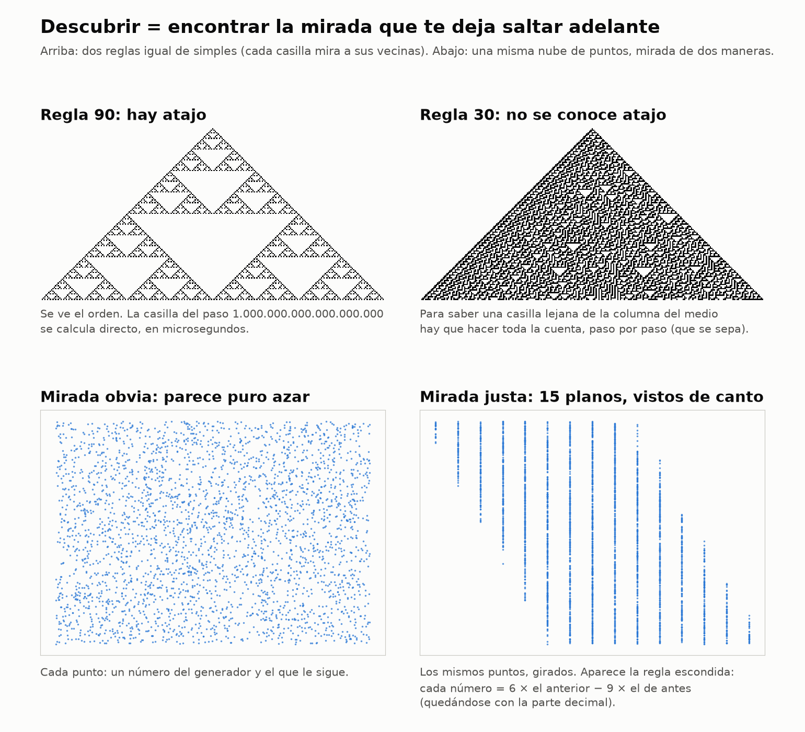

# Reformulación (2026-11-15): descubrir = encontrar un atajo verificable

**Dónde estamos, qué dijo la cumbre de ARC, y una línea de investigación candidata.
PROPUESTA — NADA DE ESTO ESTÁ DECIDIDO NI CONSTRUIDO.**

> **Pedido de Lucas (2026-11-15):** "este proyecto pasó por muchas etapas (SREG → WAGER → la esencia del
> descubrimiento)… quiero saber dónde estamos parados, qué fueron las últimas cosas interesantes, si
> conviene un repo nuevo… vi las exposiciones de ARC-AGI (Wolfram y otros): buscá todas y, con todo lo
> investigado y lo nuevo, REFORMULEMOS y que se nos ocurra una línea de investigación prometedora."
>
> Este documento responde las cuatro cosas. Regla anti-recencia: la cumbre es una lectura más; se pesa
> contra todo lo anterior, no lo reemplaza.

## 0. En diez líneas

1. **Dónde estamos.** En la tercera etapa (la esencia del descubrimiento). El repo no cambió desde el
   23-sep. No se decidió nada y no se corrió ningún experimento desde agosto.
2. **Qué dijo la cumbre.** Wolfram: saber las reglas no es saber qué va a pasar; descubrir es encontrar
   los lugares donde se puede *saltar adelante* sin hacer toda la cuenta. Stanley: medir el descubrimiento
   abierto es difícil porque "interesante" es subjetivo; propone *niveles*.
3. **La novedad grande que no teníamos.** ARC-AGI-3 (juegos sin instrucciones) salió en marzo con la IA
   de frontera en menos de 1%. Ocho meses después el mejor modelo saca 81%, y con el arnés de su
   fabricante, 99,9%. ARC ya dice que lo próximo que quiere medir es la "innovación abierta". El
   modelo con el que medimos nosotros en agosto (gpt-5.4) saca 0,2% en esa misma tabla: **lo que
   observamos en agosto puede que ya no valga para los modelos de hoy.**
4. **Lo que encaja.** El tablero mutilado que ya conocíamos (758.148 colocaciones, o una mirada a los
   colores) es exactamente lo que Wolfram llama un "bolsillo": un atajo.
5. **La línea propuesta.** *Descubrir = encontrar un atajo verificable.* Jueguitos con la regla **a la
   vista**, preguntas tan lejanas que hacer la cuenta paso a paso no entra, y una nota exacta, sin LLM.
6. **Por qué es más limpio que lo anterior.** Como no hay nada escondido, desaparece todo lo que nos
   ensuciaba: el ruido, los datos escasos y el premio flojo. Sin atajo es *imposible*; con atajo es fácil.
7. **Qué mediría de nuevo.** Cuando lo encuentran, ¿lo *ven* o lo *buscan*? Y cuántas veces creen ver un
   atajo que no está.
8. **Honestidad.** La idea no es virgen: DeepMind publicó el mes pasado un agente que encuentra atajos
   verificados en máquinas de juguete (lo firma el autor de "LLMs can't jump"), y los agentes ya resuelven
   79% de problemas recientes de Project Euler. Lo que no existe es el *instrumento de medida* con
   controles. Y el riesgo de que los modelos de hoy lo resuelvan todo es alto.
9. **Repo nuevo y primer paso.** Repo: sí, chico, y que lo primero que entre sea un juego con su
   resultado. Primer paso: una calibración de dos días con los modelos de hoy. Necesita el GO de Lucas.
10. **El riesgo principal** no es técnico: llevamos tres reformulaciones desde agosto y ningún experimento.

## 1. Qué se leyó y cómo (honesto)

| Fuente | Cómo | Estado |
|---|---|---|
| Stephen Wolfram, charla en la ARC Prize Research Summit 2026 (23-oct-2026, MIT), [video](https://www.youtube.com/watch?v=kdaGkpIUZyY) | transcripción completa (la pegó Lucas; 30 min) | **leída entera**; las citas son textuales y salen de esa transcripción. (Los subtítulos automáticos que bajé de YouTube para esta misma charla dicen "pockets of computational *convergence*" donde la transcripción dice "*reducibility*": están retraducidos y no se usaron) |
| Kenneth Stanley, keynote "Open-Endedness", misma cumbre | subtítulos automáticos de YouTube, 5,8 mil palabras | **leída entera**, pero los subtítulos parecen retraducidos (dicen "openness"/"curiosity" donde lo esperable sería "open-endedness"/"interestingness"): **se parafrasea, no se cita textual** |
| Video de lanzamiento de ARC-AGI-3 (ARC Prize 2026) | subtítulos automáticos | **leído entero** |
| Kevin Murphy "Model Discovery Agents", François Chollet (4 min), Alexandre Bouayad "Weave of Formal Thought", Alexis Fox "PRO-LONG" | a mí YouTube me limitó las descargas (error 429); un lector secundario las leyó desde los subtítulos (la de Bouayad, en parte) | **yo NO las leí**; lo que se dice de ellas (§3.5) es de segunda mano |
| Estado de ARC: tabla oficial de ARC-AGI-3, análisis de GPT-6 Astra (3-sep-2026), página de la cumbre | abrí las tres páginas | **verificado** (§3.3) |
| Anuncios en X (ARC-AGI-4, Chollet, Knoop, Kamradt, Stanley) | X no deja leer con herramientas; un lector secundario los leyó **con el Chrome de Lucas, que tiene la sesión abierta** (solo lectura de posts públicos) | segunda mano |
| Cinco ensayos de Wolfram 2024–2026 | un lector secundario bajó el texto completo; **las citas usadas acá las comprobé yo contra ese texto** | citas verificadas; los ensayos enteros no los leí yo |
| Trabajo previo para la idea propuesta | lectores secundarios (unas 90 búsquedas, 35 páginas); **cinco fuentes las abrí y comprobé yo** (§8, marcadas ✔) | el resto, segunda mano. Antes de afirmar novedad en un paper: auditoría a texto completo (ADR 0115) |
| Los seis ejemplos de §5.4 | cuentas propias, sin LLM: [`2026-11-15-atajos-verificacion.py`](2026-11-15-atajos-verificacion.py) | **verificados** (el script corre en segundos) |

## 2. Dónde estamos parados

**Tres etapas, contadas en llano.**

1. **SREG** (repo `synthetic-research-envs`): entornos amplios para que una IA "investigue", con la nota
   puesta por otra IA. Se abandonó porque una nota opinable no prueba nada.
2. **WAGER** (repos `wager` → `research-worlds-envs`, el actual): mundos-rompecabezas con una verdad
   escondida, gemelos, y nota por fórmula (nunca por otra IA). Primero un catálogo de "vicios" del
   investigador; después el "programa de saltos": ¿el agente cambia la FORMA de su historia cuando las
   pistas lo piden? Tamaño hoy: 433 commits, 188 decisiones escritas (ADRs), unos 180 docs de research,
   75 mil líneas de Python.
3. **La esencia** (septiembre 2026 → hoy): Lucas dio el paso atrás — "¿qué es realmente descubrir? ¿cuál
   es lo mínimo? ¿se puede aislar? ¿existe o es un mito?" — y pidió juegos mínimos al estilo ARC.

**Lo sólido que deja WAGER** (vale en cualquier repo):
- *El método*: nota mecánica sin LLM; gemelos; medir contra el MEJOR rival sin el truco, optimizado
  (la lección de D1: la historia simple sacaba 0.986 y cambiarla no pagaba); la idea soplada como control;
  reglas congeladas antes de correr.
- *Lo observado* (descriptivo, sin prueba causal): los agentes compran el test y no cambian la historia;
  con la idea soplada algunos lo logran; se caen ANTES de la idea (ven lo raro y no dejan que les moleste)
  y DESPUÉS (no corren la prueba que decide; arman el candidato correcto y lo descartan).
- *La biblioteca*: casi todos los clásicos leídos enteros (Peirce, Magnani, Boden, Ohlsson/Knoblich,
  Kaplan & Simon, Klahr & Dunbar, Darden, Klein, Schmidhuber), resumidos en `WIKI-INDAGACION.md` §7.

**Dónde nos quedamos** (23-sep-2026; el repo no cambió desde entonces):
- Las revisiones externas (Codex una vez; GPT Astra cinco: dos por API y tres dentro de Codex)
  coincidieron: *dejar de agregar conceptos; una sola pregunta limpia; juegos mínimos; no reclamar
  "creatividad" todavía*.
- Sobre la mesa quedó el juego de Astra: un aparatito de un bit donde algunas entradas PASADAS importan
  (perilla: cuántas), con nota 0 = ignoraste el pasado, 1 = lo descubriste.
- Lucas definió: *abducción creativa = modificar la estructura de tu modelo de cómo funciona este mundo
  para explicar lo que la estructura anterior no podía* (Astra sugirió llamarla "estructural").
- **Nada se decidió y no se corrió ningún experimento desde agosto.**

**Las últimas cosas interesantes que vimos** (antes de la cumbre):
1. Lo que llamábamos "salto" ya tenía nombre y 90 años de método: *problema de insight*.
2. El tablero mutilado (Kaplan & Simon 1990): 758.148 colocaciones posibles, o UNA mirada (los colores)
   que lo resuelve en segundos. Y dos datos: notar no es usar (12 minutos de brecha) y cambiar cómo
   se VE el problema ayuda sin decir una palabra.
3. Dos objeciones de Lucas que quedaron abiertas y que esta reformulación toma en serio:
   *"la creatividad también es encontrar formas ya vistas; nadie cambia la forma de la nada"* y
   *"¿por qué tiene que haber primero una historia y después datos que la contradigan? ¿no puede ser un
   problema que cuesta resolver de una, y que después lográs?"*.
4. ARC-AGI-3 (juegos sin instrucciones): al lanzarlo, sus autores contaron que la IA se aferra a una
   hipótesis temprana ("latch on to an early hypothesis and be unable to deviate away") y que cree estar
   jugando a otro juego ("it thinks it's playing a different game"), por anclaje a lo que ya vio.

## 3. Qué dijo la cumbre de ARC (ARC Prize Research Summit, 23-oct-2026, MIT)

### 3.1 Wolfram (leída entera; citas textuales)

Su encargo fue hablar de "discovery and what's involved in making discoveries, how you would tell if an AI
had made a discovery". Su argumento, en cinco pasos:

1. **Saber las reglas no es saber qué va a pasar.** Hay programas simplísimos (su regla 30, la de la
   figura) cuya conducta solo se conoce corriéndolos paso a paso. A eso lo llama *irreducibilidad
   computacional*: no hay forma de acortar la cuenta. La pregunta clave:
   > "The question is, can we jump ahead? Can we figure out what's going to happen in a sort of reduced way?"
2. **Pero siempre hay bolsillos.** "there are always ultimately an infinite number of pockets of
   computational reducibility" — zonas donde sí hay una regularidad que deja saltar adelante.
3. **Eso es descubrir.** "You can think of each of those pockets of reducibility as a discovery." Y:
   "Can you discover more of these pockets of computational reducibility out in the computational universe?
   I think that is sort of the ultimate essence of the process of discovery."
4. **Lo difícil no es encontrar cosas ciertas, sino cosas que importen.** "it's very easy to find things
   that are true. It's harder to find things that are true that we care about." Y de una demostración
   automática enorme: no tiene ningún paso intermedio reutilizable — "the only interesting discovery is
   the whole result".
5. **Lo que él declara que NO sabe:** si se pueden buscar bolsillos sistemáticamente ("This is where
   things get complicated. I don't know the answers yet"); qué separa un descubrimiento significativo de
   uno irrelevante ("it is not obvious, at least to me"); y cómo contar ideas. Mostró organismos mínimos
   (programitas que mutan al azar para "vivir" más) cuya curva de progreso avanza por **mesetas y saltos**
   ("a series of breakthroughs… discoveries about how to live longer"), y admitió: "I don't have a good
   theory for characterizing kind of how to count ideas, how to know whether you have a new idea or not."

De pasada, sobre los LLMs: "you can try you know feeding these things to LLMs and see whether LLMs can
predict computational irreducible things, and of course they can't."

### 3.2 Kenneth Stanley, keynote (leída entera; paráfrasis)

Tema: **por qué es tan difícil MEDIR el descubrimiento abierto** (procesos que no paran de inventar, como
la evolución o la civilización). Dice que ARC va en esa dirección y que invención y descubrimiento son
quizá lo más importante ahora. Puntos:
- Nadie es recordado por sus notas en exámenes; se recuerda el legado creativo.
- Repasó los intentos de medirlo (estadísticas de actividad de Bedau, puntaje de calidad-diversidad,
  ANNECS de POET) y concluyó que **ninguno sirve como vara universal**, por lo mismo: no resuelven qué es
  *interesante*, y eso parece inevitablemente subjetivo.
- Trampas que enumera: lo abierto se refiere a cosas que todavía no pasaron (una idea puede tardar diez
  años en mostrar su impacto); un arenero cerrado no puede probar apertura; el consenso de expertos mide
  lo ya sabido; algo equivocado puede ser interesante; y cualquier benchmark crea un objetivo, que es
  justo lo que este campo dice que hay que evitar.
- El **juicio** es parte de lo que hay que evaluar: la capacidad de mirar un resultado y decir "esto es
  raro, investiguémoslo".
- Dos sistemas con la misma nota pueden tener representaciones internas distintas, y eso decide qué
  podrán descubrir después.
- Recomendación final: no una definición definitiva sino **niveles**, como ARC hizo con sus versiones.

### 3.3 ARC-AGI-3 (video de lanzamiento, leído entero)

Cientos de jueguitos hechos a mano, cerca de mil niveles, sin instrucciones: hay que explorar, descubrir
el objetivo, armar un modelo del mundo y aprender de un nivel al siguiente. La nota no es "ganaste o no"
sino **cuántas acciones gastaste comparado con una persona** (eficiencia). Al lanzar, la IA de frontera
sacaba menos de 1%. Fallas que reportan: no anticipa consecuencias a cinco o seis jugadas; se aferra a su
primera hipótesis; confunde el juego con otro que conoce. Premio 2026: 2 millones de dólares.

**Qué pasó después** (tabla oficial de [arcprize.org/leaderboard](https://arcprize.org/leaderboard),
leída el 15-nov-2026; verificado):

| Modelo | Fecha | Arnés neutral | Arnés del fabricante |
|---|---|---|---|
| GPT-5.4 (el que usamos en agosto) | mar-2026 | 0,2% | — |
| Claude Opus 5 | jul-2026 | 30,2% | — |
| GPT-6 Astra | sep-2026 | 62,7% | 99,9% |
| Gemini 4 Carbon | nov-2026 | 65,1% | 99,1% |
| Claude Fable 5.2 | nov-2026 | **81,2%** | 97,7% |

("Arnés" = el programa que le pasa el juego al modelo y le guarda las notas. Según la descripción de ARC
que leyó el lector secundario: el neutral es igual para todos; el del fabricante conserva el razonamiento
interno del modelo entre jugadas.)

En su [análisis de Astra](https://arcprize.org/blog/astra) (3-sep-2026, verificado) ARC cuenta que el
modelo convierte las mecánicas desconocidas en modelos simbólicos compactos, con su propia notación; que
el patrón es de todo o nada (o entiende el juego y lo juega con eficiencia humana, o no); y que
ARC-AGI-3 es cerrado y determinista: saturarlo no prueba inteligencia general. Lo que dicen que sigue:
"how to evaluate recursive self-improvement and open-ended innovation".

**Lo que esto nos dice a nosotros.** La tanda principal de WAGER en agosto ("compran el test y no cambian
la historia"; Perfiles, `gpt-5.4 × n=10`) se corrió con gpt-5.4, que en esta tabla saca 0,2%. En mundos cerrados con la regla escondida,
los modelos de hoy exploran, arman un modelo y lo corrigen. Nuestros mundos no son los juegos de ARC,
así que esto no prueba que el hallazgo de agosto haya caducado — pero obliga a volver a medir con los
modelos actuales antes de afirmar nada sobre "los agentes".

### 3.4 Lo que Wolfram viene escribiendo (ensayos 2024–2026; citas comprobadas contra el texto)

- **"Can AI Solve Science?"** (5-mar-2024). Encontrar una regularidad es encontrar una *representación
  reducida*; y a veces el trabajo es dar con la mirada correcta:
  > "At some level we can think of it as a story of 'finding the right parametrization' or the 'right
  > coordinate system'."

  Su ejemplo es una nube de puntos que parece al azar hasta que se la gira al ángulo justo (el panel de
  abajo de la figura reproduce esa idea con otro ejemplo). Sobre qué bolsillos existen fuera de la ciencia
  conocida: "Mostly we don't know." Sobre lo interesante, coincide con Stanley:
  > "There's no abstract notion of 'interestingness' that an AI or anything can 'go out and discover'
  > ahead of our choices."

  Pero deja una pista operativa de qué concepto vale la pena sumar:
  > "if some particular new concept—or, say, new theorem—seems to be a 'nexus' for reaching things, that
  > becomes a target for a concept that's worth us 'adding'."

  Y una duda que se puede poner a prueba (sobre usar una red para guiar una búsqueda por mutaciones):
  > "while computational irreducibility probably helps in making things 'effectively random enough' that
  > we won't get stuck, it makes it difficult to have something like a neural net successfully tell us
  > 'which way to go'."
- **"Why Does Biological Evolution Work?"** (3-may-2024). El modelo mínimo de evolución de la charla.
  Y una frase que une su idea con la nuestra de "historia":
  > "Whenever we manage to come up with a 'narrative explanation' or a 'natural law' for something, it's
  > a sign that we've found a pocket of computational reducibility."
- **"Towards a Theory of Bugs"** (21-jul-2026). Un descubrimiento es, mirado al revés, una sorpresa: algo
  que rompe lo que esperábamos. Y un aviso contra confiar en un patrón por haberlo visto muchas veces:
  encontró una máquina que suma 1 correctamente para todos los números hasta 62, "but then suddenly at
  n = 63 doesn't give 64 but instead gives 72". La pregunta que deja:
  > "How do we know if we're 'stuck in a pocket of reducibility', or are actually seeing the whole
  > 'spectrum of behavior', bugs and all?"
- **"What's the Future for Pure Math Research in the Age of AI?"** (28-sep-2026). Resolver problemas es
  lo medible y lo más al alcance de la IA; lo difícil es qué preguntar:
  > "Properly define a goal and AI can be very helpful. Without a goal, it doesn't know where to go."

  Y sobre el salto de vocabulario (lo que WAGER llamaba "cambiar la forma de la historia"):
  > "even to solve a problem stated in terms of existing mathematical concepts it's common to have to
  > 'break out of the system' and invent new concepts—a classic example being the need for complex
  > numbers in finding even real solutions to cubic equations."
- **"'Endless Forms Most Beautiful and Most Wonderful': Ruliobiology…"** (23-oct-2026, el mismo día de la
  charla). La evolución "se le ocurre una idea y se queda con ella", y las ideas se construyen unas sobre
  otras. Pero cómo caracterizar eso sigue abierto:
  > "Eventually one may hope to have a general characterization (and perhaps theory) of this
  > 'progression of ideas'. But, for now, that is something for the future."

### 3.5 Las otras charlas y hacia dónde va ARC (segunda mano, salvo lo marcado ✔)

**Las otras cuatro charlas** (leídas por un lector secundario desde los subtítulos; yo no las leí):
- **François Chollet** (apertura, 4 min): nombró dos huecos — invención y apertura. Los modelos rinden
  cuando hay objetivo claro, progreso medible y pocas acciones posibles (ARC-AGI-3 es un ejemplo de ese
  régimen); son flojos en insight e ideas originales. Los próximos benchmarks deberían medir hacer
  preguntas, gusto y curiosidad, sin señal de premio.
- **Kevin Murphy** (Google DeepMind), "Model Discovery Agent"
  ([arXiv:2608.09696](https://arxiv.org/abs/2608.09696)). **Este paper ya lo habíamos leído el
  13-ago-2026** (el HTML completo de su primera versión; registro en `docs/lectura-de-fuentes.md`): un LLM propone estructuras de modelo, la
  estadística las puntúa, y el próximo experimento se elige por cuánta información aporta. La pieza que
  nos toca, citada en ese registro: "If the error is too large, MDA expands the hypothesis space by
  prompting the LLM to suggest a novel unnamed mechanism". Es el "salto" de WAGER, disparado desde afuera
  del agente, en mundos con la regla escondida. La charla en sí no la leí.
- **Alexis Fox** (Duke), "PRO-LONG" (arXiv:2607.20064): memoria para agentes de horizonte largo (guardan
  todo el registro y lo consultan con código); mejora en ARC-AGI-3. Nombra el quedarse pegado a la primera
  hipótesis.
- **Alexandre Bouayad** (G-Research / INRIA), "Weave of Formal Thought" (arXiv:2606.25987): que el modelo
  use la gramática del código como borrador al generar. Poco que ver con lo nuestro.

**Hacia dónde va ARC:**
- El 12-sep-2026 anunciaron en X que **ARC-AGI-4 será un benchmark de "innovación abierta autónoma"**,
  previsto para el primer trimestre de 2027. No hay formato ni reglas de puntaje publicados.
- Mike Knoop (cofundador de ARC Prize): ningún modelo mostró invención o descubrimiento abiertos, y **no existe una
  medida formal de la división entre creatividad y razonamiento**. Greg Kamradt (de ARC Prize; firma el
  análisis de Astra): prefiere benchmarks que midan aporte a una frontera de conocimiento antes que
  completar tareas.
- **Una tensión entre autores, que se registra sin arbitrar:** Chollet sostiene que la ciencia es
  encontrar el modelo simbólico que más comprime las observaciones; Stanley, que la ciencia no es solo
  compresión (lo no observado no se puede comprimir) y que elegir el problema es parte del trabajo. La
  propuesta de este documento cae del lado de Chollet y Wolfram; la objeción de Stanley es la fila
  "propósito" del mapa de §4.

**El hilo de "LLMs can't jump"** (el paper del que salió nuestro programa de saltos):
- ✔ Su autor es Tom Zahavy (ICML 2026). ✔ Zahavy es también el último autor del paper de DeepMind de
  octubre sobre encontrar atajos en máquinas de juguete (§8.1). O sea: quien planteó "no pueden dar el
  salto" está estudiando el descubrimiento justamente como *encontrar atajos verificados*.
- Respuestas que no leímos (cola de lecturas): ✔ Balani & Panda, "LLMs Don't Pay for the Jump"
  ([arXiv:2608.14397](https://arxiv.org/abs/2608.14397), 14-ago-2026) — según su resumen, un argumento
  teórico, sin experimentos propios, de que para abducir hace falta un mecanismo por el cual equivocarse
  salga caro: "a system must have some physical mechanism through which epistemic error becomes costly
  enough to force revision". Recuerda a la lección de D1 de Lucas ("si no penaliza, no hay motivo para
  cambiar"), pero es un argumento físico, no un resultado. Shi, Li & Hernández-Lobato, "When the
  Canonical Completion Is Wrong" (arXiv:2608.26187); y la aclaración del propio Zahavy de que es una
  posición personal acotada.

**Otros trabajos nuevos, julio–noviembre 2026** (no verificados): DiG-bench (arXiv:2608.12593),
ExplorationBench (2609.30199), "Can LLM Agents Discover?" (2608.30047: la novedad de los agentes no se
convierte en rendimiento), PotARCin (2609.27288). Todos con la regla escondida.

## 4. Lo que encaja (y por qué no es casualidad)

Wolfram llegó, por el lado de la computación, al mismo lugar al que nosotros llegamos por el lado de la
psicología. Dos ejemplos que ya conocíamos, dichos con sus palabras:

- **El tablero mutilado** (Kaplan & Simon 1990): se puede probar colocación por colocación (758.148; un
  estudiante llenó 61 páginas) — eso es el camino paso a paso. O se puede notar que cada dominó tapa una
  casilla blanca y una negra y que faltan dos del mismo color — eso es un *bolsillo*: una mirada que deja
  saltar al resultado. La heurística que ellos encontraron en los buenos resolvedores se llamaba,
  literalmente, "notar invariantes" (cosas que no cambian).
- **El acertijo MU** (Hofstadter): con cuatro reglas para reescribir letras, ¿se llega de `MI` a `MU`?
  Probando, las cadenas alcanzables explotan (3, 6, 11, 25, 69, 278, 1.590, 10.068…) y `MU` nunca
  aparece. La mirada que lo resuelve: la cantidad de letras `I` nunca es múltiplo de 3. Imposible, en una
  línea.

En los dos casos pasa lo mismo: **todo está a la vista** (no hay nada escondido), **el camino obvio no se
puede pagar**, y **existe una mirada que lo vuelve corto**. Eso es exactamente lo que Lucas describió el
23-sep cuando objetó el diseño de "historia + datos que la contradicen": *"¿no puede ser un problema
que cuesta resolver de una, y que después lográs?"*. Sí: es la otra mitad, y es la que nunca medimos.

**Un mapa para ordenar** (síntesis propia; hipótesis de trabajo, no resultado). Cuando un problema no sale
por el camino obvio, te puede faltar una de cuatro cosas:

| Qué te falta | Dicho fácil | Qué hacés para destrabarlo | Quién lo estudió | ¿Lo medimos ya? |
|---|---|---|---|---|
| **Datos** | "no lo sé" | experimentar: elegir qué mirar | Wason; Klahr & Dunbar | WAGER lo tocó (comprar evidencia) |
| **Vocabulario** | "no lo puedo decir" | cambiarle la forma a la historia (agregar una pieza) | Peirce, Magnani, Boden; el "salto" de WAGER | sí: Perfiles y D1 (el aparato con memoria de Astra quedó diseñado, sin correr) |
| **Atajo** | "lo puedo calcular, pero no lo puedo pagar" | encontrar otra mirada que lo vuelva barato | Kaplan & Simon; Wolfram; Schmidhuber | **nunca** |
| **Propósito** | "no sé qué vale la pena buscar" | elegir el problema | Stanley | nadie sabe cómo (según el propio Stanley) |

Lo que este mapa cambia: "¿los LLMs pueden dar el salto?" deja de ser una pregunta vaga y se parte en
cuatro, cada una con su juego mínimo. Toda la historia de WAGER vive en las dos primeras filas. La cumbre
de ARC está discutiendo la tercera (Wolfram) y la cuarta (Stanley). **La tercera es la más limpia de medir.**

## 5. La idea: descubrir = encontrar un atajo verificable

### 5.1 En una frase

> **Un descubrimiento, en su forma más primitiva, es encontrar una manera de saber el resultado sin
> recorrer todo el camino — y poder comprobar que funciona.**

El descubrimiento más chico imaginable: notar que algo se repite. Si sé que se repite cada 7, sé qué pasa
en el paso mil millones sin llegar hasta ahí.

### 5.2 El juego (lo que vería un agente)

1. **Un sistema simple con la regla a la vista.** Una fila de casillas que se actualizan todas juntas
   mirando a sus vecinas (un *autómata*, como los de la figura), una maquinita de reescribir letras, un
   tablero con movimientos. No hay verdad escondida: el agente puede leer la regla y correrla.
2. **Preguntas lejanas.** "¿De qué color es la casilla 12 en el paso 1.000.000.000.000.000.000?", "¿se
   puede llegar de este estado a este otro?". Tan lejos que correr la regla paso a paso no entra en ningún
   presupuesto.
3. **Un banco de pruebas.** El agente puede jugar con el sistema en chico todo lo que quiera, buscar
   regularidades, y comprobar sus ideas contra la simulación en tamaños accesibles. Tiene un tope de
   tiempo de máquina.
4. **La entrega:** un programita que contesta las preguntas lejanas rápido. Para cada pregunta puede dar
   su respuesta con una probabilidad ("90% negro") o admitir que no sabe ("50/50").
5. **La nota:** se comparan sus respuestas con la verdad, calculada aparte. Es la misma escala que propuso
   Astra en septiembre: **0 = no encontraste nada y lo admitiste; 1 = acertaste todo; negativo =
   afirmaste con confianza algo que era falso.**

### 5.3 Por qué cumple todo lo que veníamos pidiendo

| Lo que pedíamos | Cómo lo cumple |
|---|---|
| "Sin el truco te va mal" | No es que te va un poco peor (el 0.986 de D1): **es imposible**. Sin atajo no hay forma de contestar el paso 10¹⁸. |
| "Con el truco soplado te va bien" | Decirle "fijate si se repite" o "fijate si algo se conserva" (la idea, no la solución) tiene que alcanzar. Es el control de siempre. |
| "Que el agente pueda VER que le va mal" | Puede comprobar su atajo contra la simulación en chico cuando quiera. El chequeo es suyo y está a mano. |
| Algo limpio (como NewtonBench) | Sin nada escondido no hay ruido, ni datos escasos, ni premio flojo. Regla exacta, verdad exacta. |
| Nota sin LLM | Comparación exacta contra la verdad. Ni rúbrica ni juez. |
| Gemelo | Un sistema parecido donde NO hay atajo conocido. Lo correcto es decir "50/50". |
| "¿Es memoria?" | La regla es un sorteo de un espacio enorme: ESA regularidad no está en ningún libro. El *molde* ("se repite", "se conserva") sí puede ser conocido — y, como dijo Astra, usarlo bien cuenta como éxito: medimos el hallazgo, no de dónde salió. |
| "Mejor rival" (lección de D1) | Un buscador mecánico que prueba miradas en orden, con el mismo presupuesto (§5.6). |
| Sin reclamar "creatividad" | El claim es "encontró un atajo verificado, de tal tipo, a tal profundidad, con tanta búsqueda". Nada más. |

### 5.4 Seis ejemplos, verificados con cuentas (sin LLM)

Todo sale de [`2026-11-15-atajos-verificacion.py`](2026-11-15-atajos-verificacion.py).

| Juego | El camino obvio | El atajo | Lo que dio la cuenta |
|---|---|---|---|
| **1. El todo es la suma de las partes** — la regla 90 (cada casilla es la suma de sus dos vecinas, donde 1+1 = 0) | simular: el costo crece con el cuadrado del tiempo | la casilla del paso *t* se lee directo de los dígitos binarios de *t* y de su posición | el atajo coincide con la simulación en los 70 primeros pasos completos; 1.000 preguntas en el paso 10¹⁸ en 0,2 milisegundos |
| **2. Repetición** — un autómata en un anillo de 14 casillas con regla al azar | simular 10¹⁵ pasos | tiene que entrar en un ciclo: acá, 69 pasos de arranque y después se repite cada 1.428 | el estado en el paso 10¹⁵ sale con 1.168 pasos; verificado contra simulación directa a distancia 4.370 |
| **3. Algo que nunca cambia** — el acertijo MU | explorar cadenas: 10.068 a profundidad 8, y creciendo | "la cantidad de I nunca es múltiplo de 3" | se cumple en las 10.068 cadenas; `MU` no aparece |
| **4. Gemelo sin atajo** — la regla 30, columna del medio | simular | ninguno conocido | 48% de unos; el mejor "período" encontrado acierta 53,7% (el azar: 50%) → lo correcto es decir 50/50 |
| **5. Disfraz** — una regla "suma de las partes" con 5 símbolos en un anillo de 23 casillas, pero con los símbolos renombrados | la prueba estándar deja de verla; simulando 200.000 pasos no se repite nada (el ciclo real mide 794.728.597.005.208 pasos) | deshacer el renombre y saltar | un buscador mecánico que prueba los 120 renombres lo destapa (sirven 20; el primero, en el intento 6); el atajo recuperado coincide con la simulación del sistema disfrazado en los pasos 1, 3, 50, 777 y 1.500; el estado en el paso 10¹⁸ sale en 2 milisegundos |
| **6. Trampa** — la regla 110 en un anillo de 300 casillas: una casilla que parece repetirse | — | **no hay**: es un patrón que se rompe | la casilla repite el mismo dibujo de 7 pasos 118 veces seguidas (827 pasos) y en el paso 1.227 deja de hacerlo, porque le llega una estructura que venía viajando por el anillo |

El ejemplo 6 muestra el falso descubrimiento en miniatura (es el "hasta 62 anda bien y en 63 da 72" de
Wolfram): **haberlo visto 118 veces no lo vuelve ley**. Quien mira solo la casilla preguntada se equivoca;
quien mira el sistema entero ve venir lo que la rompe.

**Nota de diseño que salió de hacer la cuenta antes de construir:** con 2 o 3 símbolos, o con bloques de
2 bits, *todo* renombre es inofensivo — no esconde nada (6 de 6; 24 de 24). Recién con 5 símbolos
esconden 100 de 120; con 7, 4.998 de 5.040; con bloques de 3 bits, 38.976 de 40.320. O sea: el disfraz
necesita por lo menos 5 símbolos o bloques de 3 bits.

### 5.5 Tres clases de mundo y una lista de formas de atajo

**Tres clases** (el agente no sabe en cuál está):
- **Con atajo**: existe una mirada que deja saltar. Encontrarla paga.
- **Sin atajo** (gemelo): no se conoce ninguna. Admitirlo paga; inventar cuesta.
- **Trampa**: hay un patrón que aguanta mucho y se rompe. Paga distinguir "lo vi muchas veces" de "tiene
  que ser así" (derivarlo de la regla, o mirar el sistema entero).

**Y una cuarta clase, para más adelante: mundos salvajes.** En las tres de arriba el atajo (o la trampa)
lo plantamos nosotros, así que solo pueden contener trucos que ya conocemos. Un modelo que conozca todos
los moldes los termina resolviendo, como pasó con ARC-AGI-3. La salida: reglas sorteadas al azar donde
*nadie* sabe si hay atajo. La verdad se calcula igual, a fuerza bruta, hasta una distancia que nosotros
podemos pagar (con mil veces más cómputo) y el agente no. Si el agente acierta ahí, encontró un atajo que
nadie plantó: un descubrimiento chiquito pero genuino sobre un programa que nadie había estudiado. No se
agota con moldes conocidos, y cada acierto agrega un dato nuevo — lo que, según el lector de §3.5,
Kamradt llama aportar a una frontera de conocimiento. Es el experimento de Zenil de 2011 (§8.1) con agentes en lugar de un buscador
de fórmulas. **Está por diseñar; nada de esto está verificado.**

**Formas de atajo** (una primera lista, tomada de las maneras en que la matemática y la física suelen
acortar una cuenta; son *familias de mundos*, NO una teoría de la mente):

| Forma | La mirada | Un descubrimiento famoso de ese tipo |
|---|---|---|
| **Repetición** | "esto vuelve a pasar cada tanto" | los eclipses (ciclo de Saros) |
| **Conservación** | "hay algo que nunca cambia" | la energía; el tablero mutilado; MU |
| **Simetría** | "si lo doy vuelta, es lo mismo" | las leyes no dependen de dónde ni cuándo |
| **Superposición** | "el todo es la suma de las partes" | ondas, Fourier |
| **Independencia** | "son dos problemas que no se tocan" | separar variables |
| **Autosemejanza** | "la parte se parece al todo" | fractales |
| **Mirar de lejos** | "en promedio, es simple" | temperatura en vez de moléculas |
| **Destino** | "termine como termine el camino, cae en el mismo lugar" | equilibrios |

Varias de estas ya están catalogadas en la física para estos mismos sistemas de juguete (§8): no es una
lista inventada. La advertencia de Astra del 23-sep sigue en pie: que estas formas correspondan a
habilidades separables de un agente es una pregunta empírica; la prueba sería la transferencia (¿haber
encontrado una conservación ayuda con la siguiente conservación y no con una repetición?).

**La perilla de dificultad: cuán disfrazado está el atajo.** Sin disfraz, las pruebas de siempre ("¿se
repite?", "¿el todo es la suma de las partes?") lo encuentran. Con disfraz (símbolos renombrados,
casillas agrupadas de a bloques, varias cosas a la vez), primero hay que dar con la mirada correcta. Es
el "right coordinate system" de Wolfram y la nube de puntos de la figura.

### 5.6 La medida nueva: ¿lo ven o lo buscan?

*(Aviso del 15-11, tras la segunda pasada de trabajo previo, §8.6: la **pregunta** no es nueva. Han et al.
2025, "Creativity or Brute Force?", y Hu et al. 2026 ya la plantearon, las dos veces con un LLM leyendo
la solución para decidir. Lo que no apareció es **esta manera de medirla**: sin juez, por cómo crece el
esfuerzo, con el atajo plantado. Y una regla que agrega esa lectura: la pendiente se mide solo sobre los
casos resueltos, porque el esfuerzo baja cuando un modelo se rinde.)*

Es la respuesta más honesta que encuentro a la pregunta de Lucas del 23-sep: *"si lo resuelve, ¿cómo
sabemos que fue creatividad?"*.

- **El problema.** Que el agente encuentre el atajo no dice cómo lo encontró. Pudo probar la lista de
  trucos conocidos uno por uno, con paciencia y sin ninguna idea.
- **Lo que sí se puede medir.** Un *buscador mecánico* es un programa sin ideas: prueba las miradas
  posibles en orden hasta que alguna funciona. Para cada juego sabemos de antemano cuántos intentos
  necesita (en el ejemplo 5: como mucho 101; con disfraces más hondos, miles o millones).
- **La comparación.** Si el agente llega con una búsqueda parecida a la del buscador mecánico, *lo buscó*.
  Si llega con muchísima menos, *lo vio*: algo lo guió hacia la mirada correcta sin probar todas.
- **Lo que no dice.** No certifica qué pasó adentro. Mide una ventaja sobre la búsqueda a ciegas. Es el
  mismo espíritu que ARC-AGI-3, que cuenta acciones comparadas con una persona.

Dicho como tesis que se puede refutar: **la ventaja de un buscador inteligente sobre uno ciego debería
aparecer donde hay un atajo para encontrar, y solo ahí.** En los mundos sin atajo no debería haber
ventaja (y el agente debería darse cuenta).

**La forma más firme de medirlo: agrandar el pajar** (agregado el 15-nov, tras releer el paper de
DeepMind). Contar intentos tiene un problema: una IA puede "buscar adentro", razonando, sin que se vea.
La psicología resolvió eso hace décadas para la vista: una manzana roja entre verdes se encuentra al
instante, haya 10 o 1.000; una cara en una multitud tarda más cuanta más gente hay. Lo primero es *ver*
(el tiempo no crece con el pajar); lo segundo es *buscar* (crece). Acá se puede hacer igual: el mismo
atajo escondido en pajares cada vez más grandes. **Corrección del 15-11 (tarde), error mío:** había
escrito "entre 120 disfraces posibles, después entre 5.040, después entre 40.320". Esos son los totales,
pero el tamaño que le importa a un buscador a ciegas es *uno de cada cuántos intentos funciona*, porque
varios renombres destapan el mismo atajo. Con los números del ejemplo 5: 20 de 120 (uno de cada 6),
1.344 de 40.320 (uno de cada 30) y 42 de 5.040 (uno de cada 120). El orden de chico a grande es entonces
5 símbolos → bloques de 3 bits → 7 símbolos, no el que sugerían los totales. Solo el primero está
verificado de punta a punta; de los otros dos se contaron las opciones; pajares más grandes (por ejemplo
11 símbolos) quedan por calcular. Se mide el esfuerzo total de la IA (texto que razona, tiempo de máquina, experimentos). Un
buscador mecánico multiplica su esfuerzo con el pajar. Si el de la IA casi no crece, *ve*; si crece con
el pajar, *busca*, aunque lo haga adentro. El resultado es un número por modelo: la pendiente.
Límites: el pajar lo definimos nosotros; si el disfraz tiene un truco de manual, la pendiente plana solo
dice "conocía el truco"; y si la IA no resuelve los pajares grandes, no hay pendiente que medir.

Por qué puede importar afuera: según el lector de §3.5, Mike Knoop (ARC) dijo en septiembre que no existe
una medida formal de la división entre creatividad y razonamiento. Esta sería una candidata chica y
mecánica: *razonar* = avanzar dentro de una mirada; *ver* = dar con la mirada correcta gastando menos
búsqueda que probarlas todas.

### 5.7 Los niveles (siguiendo el consejo de Stanley: niveles, no una vara final)

| Nivel | Qué se pide | Cómo se mide | Estado |
|---|---|---|---|
| 0 — **Encontrar la regla** | la ley está escondida; sacarla de los datos | predicción en casos nuevos | muy ocupado (NewtonBench, BoxingGym, WAGER, parte de ARC-AGI-3) |
| 1 — **Encontrar un atajo** | la regla está a la vista; saltar adelante | preguntas lejanas bajo tope, verdad exacta, mundos sin atajo y trampas | **la propuesta** |
| 2 — **Encontrar algo que valga la pena, sin que te digan qué** | explorar libre; después, examen sorpresa | cuánto de lo que encontraste sirve para preguntas que no conocías | idea; es la versión medible de "interesante = sirve para llegar a muchas cosas" (el "nexus" de Wolfram). **Más ocupado de lo que creía** (§8.5), y es hacia donde apunta ARC-AGI-4 |
| 3 — **Acumular** | una serie de sistemas emparentados | ¿cada hallazgo abarata el siguiente? | idea; acá viviría "contar ideas" |
| 4 — **Lo abierto de verdad** | inventar los problemas | hoy, subjetivo (Stanley) | fuera del alcance de una nota mecánica |

El nivel 1 es donde se *empieza* (lo más limpio y lo más barato). El nivel 2 es donde la cumbre dice que
nadie sabe medir ("Without a goal, it doesn't know where to go"), pero también donde se está metiendo
todo el mundo: ahí no conviene competir de frente. El lugar donde un proyecto chico puede aportar algo
propio está entre los dos: los mundos salvajes de §5.5 (preguntas dadas, respuestas que nadie conoce) y la
medida de §5.6.

## 6. Por qué esta y no las otras

| Línea | Pregunta | A favor | En contra |
|---|---|---|---|
| **Atajos, nivel 1** | ¿encuentra una mirada que vuelva barato lo que no puede pagar? ¿la ve o la busca? | la más limpia; imposible-contra-posible; cero infraestructura de "verdad escondida"; se conecta con lo que discuten Wolfram, Stanley y ARC; se puede mostrar en una imagen | riesgo de techo en las formas fáciles; la idea ya no es virgen (§8) |
| **La IA guiando la evolución** (experimento hermano) | en el modelo mínimo de Wolfram, ¿una IA que propone los cambios llega más rápido que el azar? Él duda de que se pueda guiar | barato; su modelo es reproducible tal cual; el rival (el azar) se calcula gratis; responde una duda que él mismo escribió; no se encontró a nadie que lo haya hecho en ese modelo | en ese modelo cada cambio es tocar una casilla de una tabla: la IA no tiene de qué agarrarse (un "no puede" sería culpa de la representación, no de la IA); y sobre evolución guiada por LLMs hay muchísimo escrito (§8.5) |
| El aparato con memoria (Astra, sep) | ¿revisa su historia cuando los datos la contradicen? | barato; ya diseñado | es la fila "vocabulario", la más recorrida; probablemente en techo con los modelos de hoy (no medido); sirve como calibración de nivel 0 |
| Seguir con Perfiles / el revisor | ¿qué empujón destraba al agente? | continuidad | más de lo mismo; las revisiones externas pidieron cortar |

## 7. Crítica propia (lo que puede estar mal)

1. **"Es resolver problemas de programación con otro nombre, y los modelos de hoy lo van a resolver
   todo."** Es el riesgo más serio. Encontrar el ciclo o usar la suma de las partes son trucos de manual;
   los agentes ya sacan 79% en Project Euler reciente (§8) y ARC-AGI-3 pasó de menos de 1% a 81% en ocho
   meses (§3.3). Lo más probable es que los mundos plantados fáciles salgan todos. El instrumento vive o
   muere por el disfraz hondo, las trampas, los mundos sin atajo y, más adelante, los salvajes.
   → Por eso la calibración (§10) va directo ahí, y con los modelos de hoy.
2. **"El atajo no es todo el descubrimiento."** Cierto: es una fila de cuatro. Es la que nunca medimos
   y la que Wolfram llama la esencia. No se reclama más.
3. **"El insight clásico tiene dos familias y esto cubre una."** Los fósforos y los nueve puntos son
   "soltar una restricción" (el camino estaba fuera del corral), no "acortar el camino". Eso es la fila
   "vocabulario". Comparten el acto (cambiar la mirada), pero no hay que venderlos como lo mismo.
4. **"Si lo resuelve con una lista de chequeos, ¿es descubrir?"** Funcionalmente sí (Simon: no hay magia,
   hay búsqueda con heurísticas). Lo que hay que mostrar es la ventaja sobre el buscador mecánico; si
   empata, el hallazgo es "busca, no ve", y se reporta así.
5. **"El buscador mecánico lo define el diseñador."** Sí: es una vara, no una verdad. Un agente puede
   encontrar un atajo que no estaba en nuestra lista, y cuenta igual (la verdad exacta lo verifica).
6. **"Lo interesante quedó afuera."** En el nivel 1, sí: la pregunta viene dada. El nivel 2 lo ataca.
7. **"No se puede probar que un mundo no tiene atajo."** Cierto: se declara "sin atajo conocido ni
   hallado por nuestra batería", por pregunta y no por sistema (la propia regla 30 tiene zonas regulares
   en un borde), y se premia la calibración.
8. **Nuestro propio patrón.** Tres reformulaciones en tres meses y ningún experimento desde agosto.
   Astra lo dijo en septiembre: la próxima decisión de identidad la tiene que tomar un resultado. Esta
   propuesta solo vale si lo próximo que se hace es una prueba, no otro documento.

**Qué la mata** (escrito antes de probar nada):
- *Techo*: sin ayuda resuelven casi todo, también disfrazado, esquivan las trampas y admiten los mundos
  sin atajo → se cierra (el resultado, chico pero honesto: "esto sí lo pueden").
- *Piso*: ni con la idea nombrada → el instrumento está roto.
- *Empate con el buscador mecánico* → no hay nada que llamar "ver"; se reporta y se cierra.
- *Ya existe el instrumento* → se abandona, o queda solo la parte de mundos salvajes.

## 8. Trabajo previo: qué ya existe y qué no (honesto)

**Veredicto corto: el instrumento de medida no existe, pero la idea ya no es virgen.** *(Segunda pasada
en §8.6: el veredicto sigue en pie, con el hueco más angosto — la pregunta "¿ve o busca?" ya fue
planteada por otros; lo que no apareció es medirla sin un modelo de juez y con el atajo plantado.)*

### 8.1 Los cinco más cercanos (✔ = abrí la página y comprobé lo que se afirma)

| Trabajo | Qué hace | En qué se parece | Qué le falta respecto de la propuesta |
|---|---|---|---|
| ✔ **Dos Santos, Veeriah, Havrilla, Bolt, Zuzic, Singh & Zahavy, "At the Limits of Computability: Steps Towards Autonomous AI Discovery on the Busy Beaver Frontier"**, 15-oct-2026, [arXiv:2610.22603](https://arxiv.org/abs/2610.22603) | (Google DeepMind y Universidad de Cambridge.) Un agente con Gemini (3.1 Pro) mira computadoras de juguete de 6 estados con reglas conocidas, conjetura "aceleraciones" (reglas compactas que resumen muchos pasos) y las demuestra con un verificador formal (Lean). **Qué encontró, con precisión** (cotejado el 15-11 contra el texto de la página, bajado y buscado frase por frase): de unas 1.163 máquinas sin resolver, en 52 vio algo prometedor y en 26 llegó a la demostración. En once de ellas no había ningún análisis documentado por la comunidad: para cada una demuestra que la máquina equivale exactamente a un juego de números del tipo de Collatz y que frena si y solo si ese juego llega a cierto estado. **No resuelve si frena**: cambia una pregunta opaca por una pregunta aritmética limpia ("These are new, formally verified reductions of each machine’s halting problem to an arithmetic question. Subject to community acceptance, we provisionally classify these machines as Cryptids"). En las otras quince la comunidad ya tenía reglas conjeturadas que "had not been formally verified". Detalle que importa (leído en el texto, vía lector automático de la página): la manera de mirar la cinta la arma un programa escrito por los autores (simula 5 millones de pasos, comprime la cinta y ordena los patrones por frecuencia); el LLM escribe la regla para los patrones más frecuentes y después las demostraciones. Las máquinas candidatas (unas 1.094 sin resolver) las eligieron personas | **es lo mismo**: regla a la vista, encontrar cómo saltar adelante, verificación exacta. Y en problemas abiertos de verdad | es una *cadena de descubrimiento*, no un *instrumento de medida*: en lo que leí (el resumen y unas tres cuartas partes del texto) no hay controles negativos ni comparación con un buscador que no sea un LLM; no informa cuántas conjeturas se generaron ni cuántas se descartaron, ni el costo por máquina; y no afirma nada sobre si el modelo "ve" o "busca". Refuerzo del 15-11: una búsqueda por palabras en el texto completo de la página (no es una lectura completa; las fórmulas quedaron afuera) no encuentra ninguna aparición de "baseline", "brute", "enumerat-", "ablat-", "cost", "tokens", "discard" ni "success rate". **El propio paper acota su alcance**: "we acknowledge that our current approach is not entirely open-ended. Specifically, our system currently accelerates machines exhibiting Collatz-like functions" — encuentra un solo tipo de atajo, ya estudiado por matemáticos |
| ✔ **"Agentic Euler"** (Dekoninck, Jovanović & Vechev, MathArena, 28-nov-2025, [matharena.ai/euler](https://matharena.ai/euler/)) | Project Euler: problemas de matemática donde la fuerza bruta no alcanza; el agente tiene ejecución de código y entrega un número, que se chequea exacto. Un agente con GPT-5 resolvió 79% de los problemas 943–966 | **el mismo esqueleto de tarea**: regla conocida, camino obvio impagable, respuesta exacta | acertijos escritos a mano, sin mundo para experimentar, sin tipos de atajo graduados, sin mundos sin atajo |
| ✔ **Zenil, Soler-Toscano & Joosten, "Empirical Encounters with Computational Irreducibility and Unpredictability"** (2011, [arXiv:1104.3421](https://arxiv.org/abs/1104.3421)) | toman todas las máquinas de Turing de 3 y 4 estados e intentan "ganarle a la cuenta" ("outrun the computation") con un buscador de fórmulas | **es nuestro experimento en versión anterior a los LLMs**, incluida la idea del buscador mecánico | no hay agente |
| ✔ **Israeli & Goldenfeld, "On computational irreducibility and the predictability of complex physical systems"** (Phys. Rev. Lett. 92, 2004; [arXiv:nlin/0309047](https://arxiv.org/abs/nlin/0309047)) | agrupan casillas en bloques ("mirar de lejos") en autómatas elementales; muestran que procesos irreducibles pueden volverse predecibles a escala gruesa, incluido uno que es computadora universal | **es el catálogo de una de las formas de atajo**, con sus casos negativos | no hay agente ni medición |
| ✔ **Moore, "Predicting Non-linear Cellular Automata Quickly by Decomposing Them into Linear Ones"** (1997, [arXiv:patt-sol/9701008](https://arxiv.org/abs/patt-sol/9701008)) | muchos autómatas complicados se descomponen en otros del tipo "suma de las partes" y se predicen "much faster than by explicit simulation" | **es exactamente la perilla "disfraz"** del ejemplo 5 | ídem. *(El lector lo atribuyó a "Moore & Pnin"; la página lista un solo autor: corregido.)* |

Otros, de **segunda mano** en la primera pasada (AlgoTune, Liu et al., CellARC y el de OEIS quedaron
comprobados contra su resumen oficial en §8.6): AlgoTune (Press et al., NeurIPS 2025, arXiv:2507.15887: agentes que
reescriben 154 funciones conocidas para que corran más rápido; reportan que los modelos "fail to discover
algorithmic innovations"); Liu et al., "Transformers Learn Shortcuts to Automata" (ICLR 2023,
arXiv:2210.10749: ahí el "atajo" vive dentro de las capas de la red, no lo descubre un agente — la palabra
*shortcut* ya está tomada); benchmarks de autómatas donde la regla está ESCONDIDA (CellARC,
arXiv:2511.07908; Rodkin et al., arXiv:2508.16745: la precisión se cae cuanto más pasos adelante se pide);
Hattori & Takesue 1991 (test de cantidades que se conservan); el benchmark de OEIS (arXiv:2411.04372); y
"LLMs versus the Halting Problem" (arXiv:2601.18987: veredictos con opción "no sé" y castigo asimétrico).

### 8.2 Qué sería nuevo de verdad

1. **Mundos sin atajo y trampas, con la abstención puntuada**: medir el *falso descubrimiento* de un
   agente descubridor. No se encontró en ningún benchmark de IA.
2. **El tipo de atajo y la profundidad del disfraz como variables controladas**, con un buscador
   mecánico de vara: la pregunta "¿lo ven o lo buscan?". *(Corrección del 15-11, §8.6: la pregunta ya
   la plantearon Han et al. 2025 y Hu et al. 2026, las dos veces con un LLM de juez. Lo nuevo sería
   contestarla sin juez, con el atajo plantado.)*
3. **El control de la idea nombrada**, que separa "no puede" de "no se le ocurre".
4. **Empaquetarlo como medición**: regla conocida + experimentación libre + preguntas lejanas bajo tope.

### 8.3 Lo que un revisor escéptico va a decir (y tiene razón en parte)

- **"Es Project Euler con otro nombre, y los agentes con código ya lo resuelven."** Es la objeción más
  fuerte. En el extremo fácil, sí. El aporte tiene que estar en el extremo disfrazado, en las trampas,
  en los mundos sin atajo y en la comparación con el buscador. Si eso no da señal, no hay paper.
- **"Las estructuras plantadas son de manual: el éxito puede ser recuerdo."** Cierto, y no se esconde:
  el claim es funcional.
- **"Las herramientas de siempre explotan la regularidad sin ninguna idea."** Por eso la vara es el
  buscador mecánico con el mismo presupuesto.
- **"La verdad exacta ya castiga al que inventa; el mundo sin atajo agrega solo una métrica de
  abstención."** Sí: agrega eso, más cuánto presupuesto quema antes de rendirse. La trampa agrega otra
  cosa: separar al que induce del que deriva.
- **"DeepMind ya mostró agentes encontrando atajos verificados en problemas abiertos; mundos plantados
  parecen un juguete al lado."** Es la diferencia entre un hallazgo y un instrumento: ellos muestran que
  se puede; falta medir cuándo, cuánto, y con qué tasa de falsos.

### 8.4 Lo que cambió en la propuesta por haber leído esto

- **"¿Pueden encontrar atajos?" ya está contestado: sí, a veces.** La pregunta libre es la de medición:
  *¿de qué tipo, hasta qué disfraz, con cuánta búsqueda, y cuántas veces creen ver uno que no está?*
- **El titular deja de ser "nadie lo hizo"** y pasa a ser "nadie lo midió con controles".
- **El riesgo de techo subió.** La calibración tiene que apuntar al extremo difícil desde el primer día.

**Sobre medir "ver contra buscar" agrandando el pajar** (dos búsquedas rápidas el 15-nov; NO es una
auditoría — **la búsqueda más seria está en §8.6 y encontró vecinos más cercanos que estos**): no apareció nadie que use la pendiente del esfuerzo para separar ver de buscar en
descubrimiento. Lo más cercano, todo de segunda mano: ZebraLogic (arXiv:2502.01100: la precisión se
desploma cuando el espacio de búsqueda pasa de cierto tamaño); HypoSpace (ICML 2026: los modelos dan
vueltas en una parte chica del espacio de hipótesis); Elenchos (arXiv:2607.12733: abducción con cambios
escondidos que interactúan); y un estudio que aplica el paradigma de búsqueda visual a modelos con visión
(arXiv:2510.19678), pero para la vista literal, no para descubrir.

### 8.5 Trabajo previo de las otras dos ideas (segunda mano; el lector chequeó los identificadores contra arXiv)

**El nivel 2 ("vale lo que te ahorra después") está más ocupado de lo que creía.**
- *Explorar sin objetivo y después rendir un examen*: WorldTest/AutumnBench (Warrier et al., ICML 2026,
  arXiv:2510.19788: 43 mundos, 129 tareas; 517 personas superan a los modelos de frontera); Ye et al.
  2026, "Look Before You Leap" (arXiv:2605.16143: exploración libre → resumen de lo aprendido → tareas
  resueltas por un ejecutor fijo).
- *"Interesante = lo que ahorra trabajo después", ya hecho número*: Patel et al. 2026 (arXiv:2609.28603:
  en matemática formal, el interés de un teorema medido contra las líneas de demostración que ahorra en
  toda la biblioteca); DreamCoder y Stitch (el valor de una pieza es cuánto comprime o acelera lo que
  sigue). ✔ Herrmann & Schmidhuber 2026, "Interestingness as an Inductive Heuristic for Future
  Compression Progress" ([arXiv:2605.14831](https://arxiv.org/abs/2605.14831)): teoría.
- *Qué no se encontró*: puntuar lo que un explorador libre deja escrito por cuánto le ahorra a un
  resolvedor **mecánico** de referencia.
- *La objeción más fuerte*: la familia de preguntas del examen **es** el objetivo. El diseñador no
  desaparece: se muda. Y ARC-AGI-4 puede ocupar ese lugar.

**"La IA guiando la evolución" y contar ideas.**
- Las dos piezas para contar innovaciones ya existen en evolución digital: volver a correr la historia
  desde cada antepasado para ver cuándo un rasgo se vuelve probable (Blount et al. 2008; Ferguson & Ofria
  2023) y apagar piezas una por una para ver cuáles eran necesarias (Lenski et al. 2003).
- Para evolución con LLMs: Pelleriti et al. 2026 (arXiv:2605.20086: etiquetan cada cambio en 121
  corridas; lo más frecuente es ajustar números y la mayor parte de la ganancia viene de un tipo de cambio
  raro — pero las etiquetas las pone un juez LLM); Gurkan et al. 2026, "Mutation Without Variation"
  (arXiv:2606.05408: sin selección, las cadenas de cambios de un LLM visitan muchas menos estructuras
  distintas que la mutación al azar clásica).
- En el modelo mínimo de Wolfram no se encontró ningún estudio con LLMs.
- *La objeción más fuerte*: en ese modelo cada mutación es cambiar una casilla de una tabla; "cambio de
  estructura" contra "ajuste" no existe ahí, y el LLM no tiene de qué agarrarse.

### 8.6 Segunda pasada de trabajo previo (15-nov, a pedido de Lucas: "lo primero es ver si alguien ya lo hizo")

**Cómo se buscó.** 21 búsquedas web con palabras distintas, en seis ángulos: la tarea (atajo para una
regla conocida), las propiedades que un programa cumple siempre, la medida "ver contra buscar", las
trampas, la abstención, y la idea de Wolfram convertida en benchmark. ✔ = leí el resumen oficial en la
API de arXiv el 15-11 (24 trabajos). ✔✔ = además bajé el texto y busqué en él cómo deciden lo que afirman.
**Ninguno está leído a texto completo.** Una búsqueda que no encuentra no demuestra que algo no exista.

**Resultado en una línea.** No apareció nadie que haga el paquete completo. Pero cada ingrediente tiene
vecinos, y dos de ellos están más cerca de lo que decía la primera pasada.

**A. La tarea: encontrar un atajo para una regla conocida**

| Trabajo | Qué hace | Qué nos dice |
|---|---|---|
| ✔ Kamath et al. 2023, "Finding Inductive Loop Invariants using Large Language Models" ([arXiv:2311.07948](https://arxiv.org/abs/2311.07948)) y ✔ Bharti et al. 2025 ([arXiv:2508.00419](https://arxiv.org/abs/2508.00419)) | Un programa conocido con un ciclo. El modelo propone una propiedad que vale en todas las vueltas (una "invariante") y un programa verificador la acepta o la rechaza ("checked for correctness using sound symbolic tools"). Bharti: 133 de 133 en el banco Code2Inv, "requiring only 1-2 model proposals per instance" | **Es la forma "conservación" de nuestra lista, con verificación exacta y sin LLM, hecha desde 2023 y ya en techo en su banco clásico.** Diferencias: prueban una afirmación dada, no predicen un futuro lejano bajo tope de cómputo; no hay disfraz graduado ni mundos sin atajo. *Se me había pasado en la primera pasada.* |
| ✔ LoopSCC ([arXiv:2411.02863](https://arxiv.org/abs/2411.02863)) y la literatura de "loop acceleration" (segunda mano) | Análisis de programas clásico, sin LLM: reemplazar un ciclo por una fórmula equivalente ("It produces symbolic expressions semantically equivalent to the loop program") | La palabra "acceleration" que usa DeepMind viene de acá: resumir muchos pasos en una fórmula es un campo con décadas. No encontré un benchmark de LLMs para esto (una sola búsqueda) |
| ✔ O'Malley et al., sucesiones de OEIS ([arXiv:2411.04372](https://arxiv.org/abs/2411.04372)) | 1000 sucesiones; el código tiene que calcularlas "accurately and efficiently ... without using lookup tables" | Mismo esqueleto que Project Euler. "overall model performance on the hard sequences is poor" (modelos de 2025) |
| ✔ LiveCodeBench Pro (Zheng et al. 2025, [arXiv:2506.11928](https://arxiv.org/abs/2506.11928)) | Problemas de competencias de programación, anotados por medallistas | "LLMs succeed at implementation-heavy problems but struggle with nuanced algorithmic reasoning and complex case analysis". De segunda mano (resúmenes, no el paper): lo que más les cuesta son los problemas que dependen de una sola ocurrencia ("observation-heavy") |
| ✔ AlgoTune (Press et al., NeurIPS 2025, [arXiv:2507.15887](https://arxiv.org/abs/2507.15887)) | 154 funciones conocidas; el puntaje es cuánto más rápido corre lo que escribe el agente | "current models fail to discover algorithmic innovations, instead preferring surface-level optimizations" |
| ✔ CellARC (Lžičař 2025, [arXiv:2511.07908](https://arxiv.org/abs/2511.07908)) | Autómatas celulares, pero con la regla **escondida**: "how quickly models infer new rules under tight budgets". GPT-5 High: 62,3% / 48,1% | Nivel 0 (encontrar la regla), no nivel 1 (atajo con la regla a la vista) |
| ✔ Menaged et al. 2026, "Can Agents Infer Environment from Interaction? Evidence from Agentic Automata Learning" ([arXiv:2606.16576](https://arxiv.org/abs/2606.16576)) | El agente descubre una máquina de estados escondida preguntando. "controlled task complexity, measurable interaction efficiency, and strong algorithms to compare against from the classic automata-learning literature" | Nivel 0, pero con **el mismo esqueleto de medición que proponemos**: dificultad controlada, eficiencia medida y un algoritmo clásico de vara |
| Wiki de Busy Beaver, página "Cryptids" (bajada el 15-11) | Entradas de noviembre de 2026 acreditadas a un miembro de la comunidad "y Claude", con pruebas en Lean | Fuera de DeepMind, la gente ya usa modelos para esto. (Son máquinas construidas para codificar problemas abiertos, no atajos descubiertos.) |

**B. La medida: ¿lo ve o lo busca?**

| Trabajo | Qué hace | Qué nos dice |
|---|---|---|
| ✔✔ **Han et al. 2025, "Creativity or Brute Force? Using Brainteasers as a Window into the Problem-Solving Abilities of Large Language Models"** ([arXiv:2505.10844](https://arxiv.org/abs/2505.10844)) | **La misma pregunta.** 242 acertijos de matemática y 236 de lógica sacados de un sitio web. Quién decide si una solución fue fuerza bruta: otro modelo ("We evaluated model reasoning strategies by prompting OpenAI o3 to judge whether each solution uses brute force") | "the tendency to use brute force decreases with model size and capability increasing"; "brute force behavior appears across all models". **Le falta**: un juez que no sea un LLM, mundos generados (los acertijos están en la web) y variar el tamaño del pajar |
| ✔✔ **Hu, Roshan & Varma 2026, "Are More Tokens Rational? Inference-Time Scaling in Language Models as Adaptive Resource Rationality"** ([arXiv:2602.10329](https://arxiv.org/abs/2602.10329)) | **Agrandan el espacio de hipótesis** (más variables candidatas) y miran cómo cambia la estrategia: "Both models exhibit a transition from brute-force to analytic strategies as complexity increases". La estrategia la clasifica un juez LLM (acierto 0,86 contra etiquetas humanas) | Es lo más parecido a "agrandar el pajar". **Pero** sus dos estrategias son dos maneras de buscar (probar pares uno por uno, o ir descartando): "both strategies have similar theoretical complexity". No hay un atajo que se pueda *ver*, y la regla está escondida |
| ✔ Estermann & Wattenhofer 2025 ([arXiv:2503.15113](https://arxiv.org/abs/2503.15113)) | Esfuerzo de razonamiento contra tamaño del problema, en un rompecabezas "which has a known linear-time solution" | "reasoning effort scales with problem size, but only up to a critical problem complexity. Beyond this threshold, the reasoning effort does not continue to increase, and may even decrease" |
| ✔ Shojaee et al. 2025, "The Illusion of Thinking" ([arXiv:2506.06941](https://arxiv.org/abs/2506.06941)) | Lo mismo en varios rompecabezas | "their reasoning effort increases with problem complexity up to a point, then declines despite having remaining token budget". **Aviso para nuestra medida: el esfuerzo baja cuando el modelo se rinde** |
| ✔ Liu et al. 2026, "When Agents Slow Down" ([arXiv:2609.15309](https://arxiv.org/abs/2609.15309)) | Cuánto rinde cada token de un agente, contra una referencia mecánica (muestreo independiente) | Comparar al agente contra un buscador "tonto" de referencia ya se hace, en tareas abiertas |
| ✔ Li, Parsert & Polgreen 2024 ([arXiv:2403.03997](https://arxiv.org/abs/2403.03997)) | LLM solo, enumerador mecánico solo, y los dos juntos, en síntesis de programas | Ídem: "LLM contra buscador a ciegas" es comparación corriente en ese campo |
| ✔ Mizumoto et al., NazoNazo ([arXiv:2509.14704](https://arxiv.org/abs/2509.14704)) | Adivinanzas que piden "insight-like representational restructuring" | Modelos 7,6%–17,6% contra 52,9% de personas. Falla típica: generan el candidato correcto y no lo eligen |

**C. Trampas y mundos sin atajo.** No apareció nada directo (tres búsquedas: patrones que valen mucho y
después fallan; modelos que ven patrones en el azar; abstenerse cuando no hay estructura). Vecinos:
✔ REFUTE (Sinha et al. 2025, [arXiv:2502.19414](https://arxiv.org/abs/2502.19414): encontrar el
contraejemplo de una solución sutilmente mala; los mejores agentes lo logran en "<9%" de los casos) y
AbstentionBench (arXiv:2506.09038, segunda mano).

**D. La idea de Wolfram convertida en benchmark para agentes.** No apareció nada (tres búsquedas, incluida
una de reacciones posteriores a la cumbre). Sí apareció **teoría más formal que la de Wolfram**, que sirve
de fundamento:
- ✔ Zwirn & Delahaye 2011 ([arXiv:1111.4121](https://arxiv.org/abs/1111.4121)): "we propose a robust
  formal definition" de irreducibilidad, bajo la cual "no computation of its nth state can be faster than
  the simulation itself".
- ✔ Liu, Ash, Goel, Krishnamurthy & Zhang 2023, "Transformers Learn Shortcuts to Automata"
  ([arXiv:2210.10749](https://arxiv.org/abs/2210.10749)): cuándo una máquina de estados admite atajo
  depende de su estructura algebraica ("O(1)-depth simulators are surprisingly common, and can be
  understood using tools from Krohn-Rhodes theory and circuit complexity"). Ahí el atajo vive dentro de la
  red, no lo descubre un agente.
- ✔ Finzi et al. 2026, "From Entropy to Epiplexity" ([arXiv:2601.03220](https://arxiv.org/abs/2601.03220)):
  "a formalization of information capturing what computationally bounded observers can learn from data".
- De segunda mano: "In-Context Algebra" (arXiv:2512.16902, ICLR 2026): redes chicas que tienen que
  inferir una estructura de grupo cuando los símbolos cambian de significado en cada secuencia. Es el
  mecanismo de nuestro "disfraz", estudiado dentro de la red.

**Qué cambia en la propuesta por esta pasada**

1. **La pregunta "¿ve o busca?" no es nuestra.** Han et al. la hicieron en 2025 y Hu et al. agrandaron el
   espacio en 2026. Lo que sigue sin dueño, hasta donde busqué: contestarla **sin juez LLM** (por cómo
   crece el esfuerzo), en **mundos generados** (sin riesgo de que el acertijo esté en la web) y **con un
   atajo plantado** contra el cual comparar. El hueco existe, pero es más angosto que "nadie lo hizo":
   es "nadie lo midió limpio".
2. **La forma "conservación" no debería ser el centro**: en su versión clásica (invariantes de ciclos) los
   modelos ya están en techo.
3. **La pendiente necesita una regla más**: medirla solo sobre casos resueltos. Si no, una pendiente chata
   puede ser rendición (Shojaee; Estermann) y no visión.
4. **Señal a favor de que hay algo que medir**: tres bancos independientes (AlgoTune, LiveCodeBench Pro,
   OEIS) reportaron en 2025 que a los modelos les cuesta justo la parte de "ocurrírsele el truco". Son
   modelos de 2025; con los de hoy no se sabe.
5. **Las trampas y los mundos sin atajo siguen siendo lo más libre.**

## 9. ¿Repo nuevo? — Sí, chico, y con una condición

**El contexto.** Un repo no es solo código: es lo que lee cada sesión nueva antes de pensar. Hoy,
cualquier sesión que arranca en `research-worlds-envs` carga un `CLAUDE.md` de 181 líneas que le ordena
el flujo de trabajo de WAGER ("nombrar el salto, diseñar mundo+tarea, validar contra el mejor rival…") y
la manda a leer un `roadmap.md` de 1.358 líneas. Detrás hay 188 decisiones escritas, unos 180 documentos de
research, 433 commits y 75 mil líneas de Python.

**El problema.** Todo eso fue hecho para otra unidad de trabajo: *casos con una verdad escondida* (con su
batería, sus rivales, su escalera, sus certificados). La línea nueva usa *jueguitos con la regla a la
vista y un verificador exacto*. De las 75 mil líneas sirven unas 400 (`wager/agent/llm_client.py`, 115;
`wager/harness/kernel_proc.py`, 271). Y las guardias automáticas (las que rompen un commit si un doc de
vicios quedó desincronizado) cuidan cosas que la línea nueva no tiene.

**La consecuencia.** Cada sesión arranca pensando con el vocabulario viejo (vicios, saltos, perillas,
escalera de verdades) y hay que sacarla de ahí a mano. Pasó en estos dos meses: costó muchas vueltas salir
del marco. No es desprolijidad de nadie: el repo hace bien su trabajo, que es sostener WAGER.

**El contrapeso (hay que decirlo).** Sería el cuarto repo (`synthetic-research-envs` → `wager` →
`research-worlds-envs` → este). En agosto quedó anotado como lección: *"el patrón de arrancar de cero ya
se usó dos veces; no conviene repetirlo para reorganizar"*. La diferencia esta vez: no es reorganizar lo
mismo; cambia qué se construye. Pero el riesgo de fondo no es el repo: **son tres reformulaciones desde
agosto y ningún experimento.** Un repo limpio no arregla eso; lo puede esconder.

**La recomendación.**
- **Sí al repo nuevo**, porque la dirección (juegos mínimos, la esencia) es estable desde septiembre aunque
  los diseños hayan cambiado. El repo es para la *pregunta*, no para esta *respuesta*: si "atajos" muere
  en la calibración, la próxima idea vive en el mismo lugar limpio.
- **Con una condición: que lo primero que entre sea un juego con su resultado, no documentos.**
- **El repo viejo no se toca ni se borra**: queda congelado como biblioteca de solo lectura (igual que
  quedó SREG), con una nota arriba que diga dónde sigue la línea.

**Qué se lleva (y nada más):**

| Se lleva | Tamaño |
|---|---|
| Una página de *lecciones heredadas*: nota sin LLM · medir contra el mejor rival sin el truco · la idea nombrada como control · gemelos · reglas congeladas antes de correr · titulares con su alcance · agentes reales temprano | 1 página |
| Un puntero a la biblioteca (el repo viejo): `WIKI-INDAGACION.md` §7, `docs/lectura-de-fuentes.md`, las lecturas de septiembre, este documento | 5 líneas |
| El cliente para llamar modelos y el proceso que ejecuta el código del agente | ~400 líneas |
| Las notas de memoria de trabajo que siguen valiendo (las reglas de Lucas, cómo consultar a Codex y a Astra). La memoria de Claude Code está atada a la carpeta del repo: hay que copiarlas a mano | 7 notas |

**Qué NO se lleva:** el sistema de ADRs, el catálogo de vicios, la lista de los 11 saltos, las guardias
de consistencia, el roadmap, la familia de wikis.

**Cinco reglas para que no se ensucie:**
1. Una sola pregunta, arriba del README. Si cambia, se cambia el README; no se agrega un documento.
2. Ningún documento de teoría antes del primer resultado.
3. Cada experimento es una carpeta: reglas congeladas, resultados crudos, y una lectura de diez líneas.
4. Topes duros: README de una página; `CLAUDE.md` de 40 líneas.
5. Las decisiones van en un solo archivo, una línea cada una.

**Nombre.** Para la pregunta, no para la idea: `essence-of-discovery` (las palabras de Lucas). `atajos` o
`jump-ahead` nombran una respuesta que puede morir en la primera prueba. *(Precisión del 15-11, tarde,
cuando Lucas preguntó por el nombre: se mantiene el criterio y se separan dos nombres — el **repo** por
la pregunta, `essence-of-discovery`, o `discovery-games` si suena grandilocuente; y el **primer juego**
adentro, por lo que hace: `jump-ahead`, en castellano `atajos`. Decide Lucas.)*

## 10. Primer paso propuesto (nada de esto se hace sin el GO de Lucas)

**Una calibración de dos días** para saber si el juego mide algo, antes de invertir en nada más.

1. **Gratis, medio día.** Unos doce jueguitos, cada uno un archivo: tres formas de atajo (repetición,
   suma de las partes, conservación) × dos niveles de disfraz (ninguno, uno hondo) + dos mundos sin atajo
   + dos trampas + dos salvajes. Cada uno con su certificado hecho con cuentas: el camino obvio no entra
   en el tope; el atajo (si lo hay) existe y es exacto; cuántos intentos necesita el buscador mecánico.
2. **Con agentes reales, un día.** Un modelo de frontera **de hoy** (los de agosto ya no sirven de
   referencia, §3.3), los doce juegos, dos condiciones (sin ayuda / con la idea nombrada), dos sorteos:
   unas 48 partidas. Costo: **no medido**; estimo decenas de dólares. Se miden las primeras cuatro
   partidas y se confirma el número antes de seguir.
3. **La lectura, escrita de antemano** (§7): techo → se cierra; piso con la idea nombrada → instrumento
   roto; empate con el buscador → "buscan, no ven", se reporta y se cierra; **señal** (resuelven sin
   disfraz, se caen con disfraz, la idea nombrada los levanta, y/o caen en las trampas o inventan en los
   mundos sin atajo) → recién ahí se arma el experimento en serio y se diseñan los mundos salvajes.

Qué falta decidir, de Lucas: (a) si la línea le cierra; (b) repo nuevo sí/no y nombre; (c) GO a la
calibración y tope de gasto; (d) si quiere que Astra revise esto antes — mi recomendación es **no** hacer
otra ronda de revisión: la propia Astra dijo en septiembre que la próxima decisión la tenía que tomar un
resultado.

## 11. Lo que NO se verificó

- Las charlas de **Murphy, Chollet, Bouayad y Fox** no las leí yo (YouTube me limitó las descargas). Lo
  que se dice de ellas en §3.5 viene de un lector secundario que leyó los subtítulos. Si Lucas pega las
  transcripciones, las leo.
- Los **anuncios en X** (ARC-AGI-4 y las frases de Chollet, Knoop, Kamradt y Stanley) son de segunda mano.
  Sí verifiqué la tabla de ARC-AGI-3, el análisis de Astra y la página de la cumbre.
- Los **mundos salvajes** (§5.5) son una idea: no hay ninguno construido ni verificado.
- La charla de **Stanley** se leyó entera pero de subtítulos que parecen retraducidos: está parafraseada.
- De los **ensayos de Wolfram** comprobé las citas, no leí los ensayos enteros.
- Del **trabajo previo**, cinco fuentes verificadas abriendo la página (§8.1) y, en la segunda pasada
  (§8.6), 24 resúmenes oficiales leídos y tres textos abiertos para buscar frases puntuales (DeepMind,
  Han et al., Hu et al.). **Nada leído a texto completo todavía.** Fueron 21 búsquedas: no agotan la
  literatura, y no busqué en revistas de psicología ni en tesis.
- Que los modelos de frontera **no estén en techo**: no se sabe. Es exactamente lo que mide la calibración.
- Los **costos** son estimaciones a ojo.
- La lista de **formas de atajo** es una lista de familias de mundos, no una teoría comprobada.
- Que los **mundos sin atajo** no tengan atajo es una conjetura, no un teorema.

## 12. Nivel arriba

- **Aprendizaje real.** Lo que WAGER llamaba "salto" (cambiar la forma de la historia) es una de por lo
  menos dos cosas distintas que la gente llama descubrir. La otra — encontrar un atajo cuando todo está a
  la vista — es la que describe el tablero mutilado, es la que Wolfram llama la esencia, y es la que
  nunca medimos. Es además más limpia de medir, porque no depende de ruido ni de premios flojos.
- **Segundo aprendizaje, incómodo.** La frontera se movió mientras reformulábamos. El modelo con el que
  medimos en agosto saca 0,2% en ARC-AGI-3; el mejor de hoy, 81%. Todo lo que WAGER "observó" hay que
  tratarlo como una foto de modelos viejos hasta volver a medir.
- **Límite del claim.** Nada de esto está probado con agentes. Los seis ejemplos verifican que los
  *mundos* existen y que las cuentas cierran; no dicen nada sobre qué hacen los modelos.
- **Explicación rival.** Puede que sea "resolver problemas de programación" con otro nombre y que los
  modelos de frontera ya estén en techo. El 79% en Project Euler, el paper de DeepMind y el salto en
  ARC-AGI-3 empujan en esa dirección. Solo una calibración lo decide.
- **¿Es el uso de mayor valor?** Sí como próxima prueba barata: dos días, pocas decenas de dólares, con
  criterios de muerte escritos. No como nueva identidad del proyecto hasta que haya un resultado.

## 13. Ledger de pendientes abiertos

| Estado | Pendiente | Próximo paso |
|---|---|---|
| **VIVO** | Decisión de Lucas sobre esta reformulación (la línea, el repo nuevo, el GO a la calibración) | Lucas |
| **VIVO** | El juego de Astra del 23-sep (dependencias del pasado) quedó sin GO | si se adopta esta línea, queda como calibración de nivel 0 o se archiva; decide Lucas |
| **VIVO** | Nombre: "abducción creativa" (Lucas) o "abducción estructural" (Astra) | Lucas |
| **VIVO** | Correcciones a `WIKI-INDAGACION.md` §6 y §7 que señaló Astra (frases que atribuyen de más a las fuentes) | esperan el OK de Lucas; sin aplicar |
| **VIVO** | ADR 0188 (las modificaciones de Codex al marco de dos mitades, ADR 0187) | sin decidir desde septiembre |
| **VIVO** | Fusión de las dos notas de dirección del 18-ago | sin decidir |
| **VIVO** | Cuatro charlas de la cumbre que yo no leí (Murphy, Chollet, Bouayad, Fox) | reintentar la descarga otro día, o que Lucas pegue las transcripciones |
| **VIVO** | Auditoría a texto completo del trabajo previo más cercano (el paper de DeepMind, "Agentic Euler" y, desde la segunda pasada, Han et al. 2025 y Hu et al. 2026) | antes de cualquier afirmación de novedad |
| ✓ | Segunda pasada de trabajo previo (§8.6): 21 búsquedas, 24 resúmenes oficiales | hecho el 15-11; el hueco quedó más angosto |
| **VIVO** | Cola de lecturas nueva: el paper de DeepMind sobre atajos (arXiv:2610.22603), las respuestas a "LLMs can't jump" (Balani & Panda; Shi, Li & Hernández-Lobato), el informe técnico de ARC-AGI-3, Herrmann & Schmidhuber 2026 | registrar en `docs/lectura-de-fuentes.md` cuando se lean a texto completo (hoy no se registran: no se leyeron) |
| **VIVO** | Volver a medir con modelos de hoy lo que WAGER observó en agosto con gpt-5.4 | solo si la línea vieja sigue; si no, queda como salvedad escrita |
| ✓ | Lectura de la cumbre (Wolfram, Stanley, ARC-AGI-3) | hecho |
| ✓ | Citas de los ensayos de Wolfram comprobadas contra el texto | hecho |
| ✓ | Trabajo previo: cinco fuentes verificadas | hecho |
| ✓ | Seis ejemplos verificados con cuentas | hecho |
